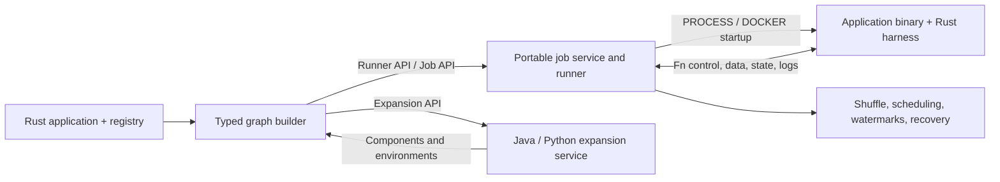

<!--
Licensed under the Apache License, Version 2.0 (the "License");
you may not use this file except in compliance with the License.
You may obtain a copy of the License at

http://www.apache.org/licenses/LICENSE-2.0

Unless required by applicable law or agreed to in writing, software
distributed under the License is distributed on an "AS IS" BASIS,
WITHOUT WARRANTIES OR CONDITIONS OF ANY KIND, either express or implied.
See the License for the specific language governing permissions and
limitations under the License.
-->

# Rust SDK design

Status: architecture proposal with an initial experimental Prism PROCESS
implementation. See the [Rust SDK quickstart](../sdks/rust/README.md) and
[tested feature matrix](../sdks/rust/features.toml). The native Prism prototype
is locally validated; the broader M1/M2 release roadmap is unfinished.
Repository baseline: `1a3f101544`. Dependency research checked on 2026-10-15.
API names, crate names, and Rust-specific URNs below are proposed.

Implementation evidence (2026-10-15): the official `grpc 0.9.0` deadline probe
failed against grpc-go. The implemented transport therefore uses Tonic 0.14.6
with a private codec for official `protobuf 4.34.0-release` messages and
descriptor-generated clients. The matching compiler/WKT pins, minimal generator
workaround and reproducible failed/passing probes are recorded in the
[dependency decision](../sdks/rust/protocol-decisions.md). This refines the
dependency proposal below without changing the public Beam model.

The first native vertical slice runs WordCount, fan-out, Flatten, grouping,
lowered wrapping sums and distributed multiset assertions on checkout Prism.
It exposed isolated PROCESS argument and data-fragment persistence fixes in
Prism. Grouped values now use shared disk spools and fallible independent
iterators, including partial consumption and an 80 MiB Prism acceptance case.
Finish-bundle outputs run in dependency order and local UTF-8 text I/O executes
entirely in Rust workers. The selected transport passes the M0 protocol gate.
Docker/Flink are optional deployment follow-ups; Java expansion and foreign I/O
are outside the completed prototype scope.
The executable API is documented in the quickstart; sketches below retain the
broader proposed design for follow-up work.

The implemented crates are `apache-beam` (facade and private harness),
`beam-model` (protocol messages/clients), and `beam-coders` (pure Rust wire
conformance). Keeping the first harness beside its registry avoids duplicating
factory/type-erasure contracts while the vertical slice is validated. Dedicated
harness, derive and testing crates can follow when those boundaries settle;
no empty placeholder crates are introduced.

## Decision and scope

Build a native Rust SDK on Beam's portability framework. A Rust application
constructs a Runner API pipeline and submits it to an existing portable job
service. Workers execute its compiled Rust code in a Rust SDK harness over the
Fn API. Runners retain scheduling, shuffles, watermarks, triggers, and recovery.

Prefer the official Protobuf project's `protobuf` 4.x runtime for protocol
messages and evaluate the official `grpc` client API first. Start local execution
with Prism's `PROCESS` environment and distributed execution with `DOCKER`.
Both allow the harness to initiate all RPCs as a client. Validate this dependency
choice in an early interoperability milestone, before growing the SDK API.
Keep RPC types inside the implementation.

Ship user code as an application binary with an explicit registry. Serialize
function identifiers and configuration, and deploy the executable separately.
The prototype targets bounded native pipelines on Prism PROCESS, including
basic local Rust text I/O. Cross-language I/O and Java expansion are optional
features, with no requirement to implement them. Docker distribution, the Flink
portable runner, and an explicitly tested streaming feature set can follow. Spark and managed runners need separate
validation and, where necessary, submission adapters. Portable execution alone
does not supply a Dataflow submission client.

Rust users gain typed pipeline construction, native processing code, and access
to Rust libraries without embedding another language runtime. Performance and
memory improvements are hypotheses to benchmark. A Rust Direct Runner, Wasm,
arbitrary closure serialization, dynamic Rust plugins, and a full native
connector catalog are outside the initial scope.

The repository's [Python/Rust example](../sdks/python/apache_beam/examples/wordcount_rust/README.md)
uses PyO3 under the Python SDK. This proposal supplies native construction and
harness APIs. Earlier native Rust SDK work at
[Beam Summit 2023](https://beamsummit.org/slides/2023/Sho-Rust.pdf) explored
compiled application deployment and worker function identification. Review it
for reusable code and lessons; do not assume its current maintenance status.

## Existing contracts

The checked-in protocol definitions are authoritative. Use them without a
Rust-specific fork of the public model.

| Contract | Repository source | Rust responsibility |
| --- | --- | --- |
| Runner API | [beam_runner_api.proto](../model/pipeline/src/main/proto/org/apache/beam/model/pipeline/v1/beam_runner_api.proto) | Components, standard transforms, coders, environments, windowing, requirements. |
| Schemas/configuration | [schema.proto](../model/pipeline/src/main/proto/org/apache/beam/model/pipeline/v1/schema.proto), [external_transforms.proto](../model/pipeline/src/main/proto/org/apache/beam/model/pipeline/v1/external_transforms.proto) | Portable Rows and expansion configuration. |
| Job API | [beam_job_api.proto](../model/job-management/src/main/proto/org/apache/beam/model/job_management/v1/beam_job_api.proto) | Prepare, submit, monitor, cancel, retrieve metrics. |
| Artifacts | [beam_artifact_api.proto](../model/job-management/src/main/proto/org/apache/beam/model/job_management/v1/beam_artifact_api.proto) | Stage and retrieve declared dependencies. |
| Fn API | [beam_fn_api.proto](../model/fn-execution/src/main/proto/org/apache/beam/model/fn_execution/v1/beam_fn_api.proto) | Control, data, state, logging, monitoring, bundle execution. |
| Provisioning | [beam_provision_api.proto](../model/fn-execution/src/main/proto/org/apache/beam/model/fn_execution/v1/beam_provision_api.proto) | Endpoints, options, dependencies, runner capabilities. |
| Expansion | [beam_expansion_api.proto](../model/job-management/src/main/proto/org/apache/beam/model/job_management/v1/beam_expansion_api.proto) | Import foreign transforms and their environments. |
| Coder conformance | [standard_coders.yaml](../model/fn-execution/src/main/resources/org/apache/beam/model/fnexecution/v1/standard_coders.yaml) | Reference encodings in nested and outer contexts. |

Implementation references include [Go harness translation](../sdks/go/pkg/beam/core/runtime/exec/translate.go),
[Go container boot](../sdks/go/container/boot.go), and
[TypeScript submission](../sdks/typescript/src/apache_beam/runners/portable_runner/runner.ts).
Prism's current [environment implementation](../sdks/go/pkg/beam/runners/prism/internal/environments.go)
handles process, Docker, and external environments. Prefer implementation and
tests when older READMEs disagree. No Rust-specific runner extension is expected
for the baseline; isolate any discovered runner defects in separate fixes.

## Protobuf and RPC selection

Message generation, RPC transport, and PCollection element encoding are three
separate decisions. Beam requires protobuf messages and gRPC interoperability;
its contracts do not require `prost` or Tonic. Element data uses Beam coders.

The older `protobuf` 3.x is `stepancheg/rust-protobuf`, whose
[maintainers announce end of life](https://github.com/stepancheg/rust-protobuf#end-of-life).
The official implementation from `protocolbuffers/protobuf` uses the 4.x line.
Its [Rust design](https://protobuf.dev/reference/rust/rust-design-decisions/)
uses opaque APIs backed by C/C++ kernels, with upb the default for open source
builds. Account for native compilation and cross-compilation. Pin a compatible
released compiler, runtime, well-known types package, and generator together;
the crate name alone is insufficient. Do not silently fall back to 3.x.

The gRPC project publishes an [official `grpc` crate](https://docs.rs/grpc/latest/grpc/).
[Tonic joined the gRPC project in May 2026](https://grpc.io/blog/grpc-welcomes-tonic/).
The documented [`grpc` 0.9 preview](https://grpc.io/blog/grpc-rust-announcement/)
supports all client RPC kinds, but is not recommended for production and lacks
server support. Its
[generator](https://grpc.io/docs/languages/rust/generated-code/) uses official
Protobuf-Rust messages. These observations apply to the checked release; they
are not a forecast of upstream stabilization.

An experimental SDK can use this client API: the harness initiates Control,
Data, State, and Logging connections, including the bidirectional stream on
which the runner sends work. Submission, staging, provisioning, and expansion
also need clients. PROCESS and DOCKER therefore need no Rust RPC server.
Defer the EXTERNAL worker-pool and Rust expansion servers until server support
is available or an adapter is validated.

M0 must generate the current Beam model and verify bidirectional streaming,
metadata, flow control, cancellation, statuses, and TLS configuration. Include
well-known types, custom enum options such as `beam_urn`, and unknown-field
retention through parse/serialize cycles. Generate standard URN constants from
model options. Record exact versions and compiler/runtime regeneration checks.

If the official client cannot pass M0, evaluate released Tonic with a private
codec and descriptor-driven bindings for official protobuf messages. Tonic's
[codec interface](https://docs.rs/tonic/latest/tonic/codec/trait.Codec.html) permits
independent encodings, but the adapter needs interoperability tests; it is not
a drop-in dependency change. Avoid duplicate `prost` models and pervasive
conversion copies. Record the failed gate and fallback cost before revising
the selection. Use one RPC implementation initially. Production readiness
requires supported dependencies and distributed validation, not preview APIs.

## Architecture and packaging



The construction layer owns typed graphs and validation. The portability layer
owns generated messages, submission, artifacts, and expansion. The harness
executes runner-supplied bundle descriptors, which may differ from the submitted
graph after fusion and combine lifting.

Proposed layout:

```text
sdks/rust/
  Cargo.toml, Cargo.lock, rust-toolchain.toml
  crates/
    beam/             # public API, transforms, options, portable client
    beam-model/       # generated messages and private RPC bindings
    beam-harness/     # execution, channels, provisioning
    beam-derive/      # optional schema/configuration helpers
    beam-testing/     # distributed assertions and Prism orchestration
  proto/              # Rust-specific payloads only
  examples/wordcount/
  tests/              # protocol and runner integration
  container/          # boot entrypoint and image build
  xtask/              # regeneration and packaging tools
```

Names are provisional. Ordinary applications depend on the public facade.
Keep generated protocol types behind an advanced API. Derive macros implement
documented traits that users can implement manually. Generate from the same
revision of `model/`; commit generated sources/kernel glue and verify
reproducible regeneration. Published packages include native build inputs and
must build outside the workspace without a Beam checkout or code generator.
Document native compiler requirements. Choose an MSRV during M0 and test it
alongside the pinned contributor toolchain.

## Construction API and ownership

`Pipeline` owns component registration. `PCollection<T>` is a cheap, clonable
graph handle with a pipeline identity and coder reference; it contains no
elements during construction. Reject handles from different pipelines. Use
namespaced component IDs and explicit transform names for predictable graphs.
Composites expand into the same graph through a `PTransform` interface.

`BeamValue` selects a default coder, with explicit overrides when needed. Initial
element types are owned and `Send + Sync + 'static`. A function borrows an input
and emits owned outputs. The runtime can share immutable inputs across fused
consumers without requiring all values to implement `Clone`. Each `DoFn` is
`Send`, used by one bundle processor at a time, and need not be `Sync`.

Proposed trait sketch:

```rust,ignore
pub trait DoFn: Send + 'static {
    type Input: BeamValue;
    type Output: BeamValue;
    type Config: BeamConfig;

    fn from_config(config: Self::Config) -> Result<Self>
    where Self: Sized;

    fn process(
        &mut self,
        input: &Self::Input,
        cx: &mut ProcessContext<'_, Self::Output>,
    ) -> Result<()>;
}
```

Default hooks provide setup, start-bundle, finish-bundle, and teardown. Setup is
not a once-per-job guarantee; teardown is best effort. Mutable function fields
are transient and cannot substitute for durable user state. `emit` preserves
input timestamp, windows, and pane; timestamp changes obey Beam's rules.
Finish-bundle outputs supply timestamps and windows explicitly.

A proposed WordCount API, not executable code in the current repository:

```rust,ignore
use apache_beam::prelude::*;

struct SplitWords;

impl DoFn for SplitWords {
    type Input = String;
    type Output = Kv<String, i64>;
    type Config = ();

    fn from_config(_: ()) -> Result<Self> { Ok(Self) }

    fn process(
        &mut self,
        line: &String,
        cx: &mut ProcessContext<'_, Self::Output>,
    ) -> Result<()> {
        for word in line.split_whitespace() {
            cx.emit(Kv::new(word.to_owned(), 1))?;
        }
        Ok(())
    }
}

fn main() -> Result<()> {
    Application::new()
        .register_dofn::<SplitWords>("example:split_words:v1")?
        .run_from_env(|p| {
            let lines = p.create("Lines", vec!["red blue red".to_owned()])?;
            let counts = lines
                .par_do::<SplitWords>("Split", ())?
                .combine_per_key("Count", SumI64)?;
            counts.assert_contents(
                "Expected counts",
                vec![Kv::new("red".to_owned(), 2), Kv::new("blue".to_owned(), 1)],
            )?;
            Ok(())
        })
}
```

`Application` installs built-in and explicit application factories before
selecting driver or worker mode. Worker mode skips the graph-building closure.
A synchronous entrypoint owns the async runtime; an async variant supports an
existing runtime. The graph-building closure stays on the driver. Distributed
functions require registration; capturing closures must not be accepted by an
API that would work locally and fail remotely.

Start with synchronous element processing on a compute pool while the async
runtime services RPCs. Async user functions need a later contract for ordering,
pending outputs, and cancellation. Multiple outputs and side inputs later add
typed tags and views without changing simple single-output processing.

## Function identity and configuration

An explicit registry maps stable IDs to monomorphized factories, retained by
ordinary Rust references. Entries declare function kind, configuration contract,
and input/output or accumulator coders. Reject duplicate or conflicting entries.
Avoid linker-dependent discovery as a correctness requirement.

Use standard `beam:transform:pardo:v1` and `ParDoPayload`, whose `do_fn` contains
the proposed private `beam:dofn:rust:v1` FunctionSpec. A Rust combine FunctionSpec
goes inside standard `CombinePayload`. Runners inspect standard envelopes;
Rust-specific payloads remain opaque outside the Rust environment.

The private protobuf envelope carries a payload version, stable function ID,
configuration format/version and bytes, registry manifest digest, and application
build ID. `BeamConfig` initially supports empty configuration and an adapter for
official protobuf messages. Declare configuration type and version in the
registry. Construct connections, caches, locks, and files during setup.
Configuration appears in pipeline artifacts; credentials use worker-side
discovery or secret references.

Never persist Rust TypeId, symbol addresses, vtables, type names, or object
memory as protocol identity. Checked internal type erasure connects a factory
to descriptor coders and rejects mismatches before processing. No dynamic Rust
ABI or unsafe object reconstruction is required.

Hash a canonical, sorted logical registry manifest rather than arbitrary
protobuf serialization. Generate one application build ID for the driver/worker
build set; record a separate checksum and target triple for each executable.
The same source, lockfile, features, and manifest can produce a macOS driver and
a Linux worker. A generic SDK image cannot supply user functions without the
application executable.

## Coders, schemas, and windows

Coder correctness precedes runner integration. Rust object serialization does
not substitute for standard Beam encoding.

| Rust representation | Beam coder suffix | Policy |
| --- | --- | --- |
| `String` | `string_utf8:v1` | Validate UTF-8. |
| `Bytes` wrapper | `bytes:v1` | Distinct from a vector of integers. |
| `bool` | `bool:v1` | Standard wire values. |
| `i64` | `varint:v1` | Beam signed representation, not ZigZag. |
| `f64` | `double:v1` | Values supported; no default key coder. |
| `Kv<K, V>` | `kv:v1` | Ordered key/value component coders. |
| `Vec<T>` / grouped `Iterable<T>` | `iterable:v1` | Known-length and block forms. |
| `Option<T>` | `nullable:v1` | Standard presence encoding. |
| Schema struct / dynamic `Row` | `row:v1` | Add for cross-language release. |
| Internal windows/windowed values | Standard window coders | Preserve timestamps, windows, panes. |

Suffixes have the `beam:coder:` prefix. Use sized numbers and checked conversion
for i32/usize. Explicit custom codecs can use standard bytes, but need a shared
contract for other-language consumers and do not automatically become Rows.

Separate deterministic key encoding from encodability. A
`DeterministicKeyCoder` contract requires canonical bytes consistent with key
equality and deterministic component coders. Validate at grouping, keyed combine,
distinct, and stateful boundaries. Reject floats, unordered maps, and arbitrary
application protobuf messages as keys by default. Protobuf serialization is
not canonical merely because it is protobuf. Custom key coders require explicit
opt-in and conformance tests.

Pass supported vectors in `standard_coders.yaml` in both contexts, including
nested framing, empty values, negative integers, Unicode, NaNs, and window/pane
boundaries. Test malformed lengths and truncation. A data message can contain
part of an element or several elements; decode across message boundaries.
List deferred coders explicitly and omit their capabilities. Rust round trips
alone do not prove compatibility.

GroupByKey outputs a fallible `Iterable<V>`, avoiding mandatory heap allocation
of a hot key's entire group. Bound buffering and spool locally for replay or
fan-out. Iterators borrow the element; remote references remain bundle-scoped.
Drain unread inline data to its encoding boundary. Add state-backed iterable
decoding with Fn State and continuation tokens before advertising that coder;
this transport feature is separate from durable user state.

Row support validates field order, encoding positions, nullability, nested Rows,
and numeric conversions. Initially reject unsupported logical types and map
key types with a field path. Derived structs and dynamic Rows share one mapping.
Document schema compatibility instead of silently dropping or reordering fields.

M1 supports global windows, default triggering, and zero lateness while preserving
full windowed-value metadata. Later add timestamps and fixed/sliding windows
with defined offsets and half-open intervals. SDKs perform window assignment
where required; runners perform grouping, merging, triggering, watermarks, and
pane scheduling. Sessions and custom windows need their own compatibility tests.

## Graph lowering and combines

Create expands into standard Impulse and a Rust function decoding a small
embedded value list. Large inputs use I/O. Map, flat-map, and filter wrap
registered ParDos. Flatten and GroupByKey use standard transform URNs.

Define `CombineFn<Input, Accumulator, Output>` with create/add/merge/extract and
optional compact operations. Its accumulator has an explicit coder and factory.
Require the Beam associativity/commutativity rules and test arbitrary partitions
and merge trees. Define SumI64 with explicit wrapping arithmetic so its result
does not depend on partitioning. An exact checked sum needs an unbounded integer
accumulator and range validation at extraction; checking each i64 addition can
fail differently for different merge orders.

Initially expand keyed combine into GroupByKey and a reduction ParDo. Before
exposing an optimizable CombinePerKey payload, support the precombine, merge,
extract, and convert-to-accumulator stages a runner may introduce. Otherwise
combine lifting could produce a descriptor the harness cannot execute. Global
combines require explicit tests for empty-input/default behavior.

## Harness and failure semantics

Boot accepts worker ID and provisioning endpoint, reads ProvisionInfo, resolves
control/logging/artifact/status endpoints, and attaches `worker_id` metadata.
Registry initialization is independent of graph construction.

For each bundle:

1. Fetch its ProcessBundleDescriptor through GetProcessBundleDescriptor and
   cache the immutable descriptor. Accept deprecated Register requests for the
   runners covered by compatibility tests.
2. Validate manifests, coders, functions, and ports; instantiate the runner's
   stage graph, including `beam:runner:source:v1` and `beam:runner:sink:v1` and
   RemoteGrpcPort coders.
3. Decode nested windowed values, execute operators, and route outputs to every
   consumer. Coordinate all inputs to Flatten.
4. Finish functions, flush output, emit each output's end marker, and complete
   required state writes when stateful features are enabled.
5. Return the matching instruction ID and metrics only after processing/output
   completion. Return an instruction error and discard its processor on failure.

Control remains responsive while bundles execute. Multiplex data by instruction
and transform ID; a data port ID is not a PCollection ID. Accept concurrent
instructions with bounded compute parallelism, byte-based queue limits, and
spooling/admission that prevents one blocked bundle from stalling unrelated
streams. Test interleaving and backpressure. Advertise multi-core processing only
when implemented; reject unsolicited capability-dependent encoding.

Support progress and standard element/user metrics. Full MonitoringInfo records
work initially; use short IDs only with the runner's declared support and
metadata lookup handling. Optional split requests may return no accepted splits;
accepted splits must account for primary and residual work. Unsupported optional
instructions return the specified instruction error. Do not request finalization
until its protocol is implemented.

Transport loss fails affected work; do not replay active bundles on reconnection.
The runner decides retries and output commitment. User errors and caught panics
fail a bundle; processors exposed to panic are never reused. Abort/OOM terminates
the worker and relies on runner recovery. User code may run again. External
side effects need idempotent or transactional connectors; bundle success alone
does not promise exactly-once writes.

Fn logs include worker, bundle, and transform identity, without element contents
by default. Bridge user logging through bounded queues with stderr fallback.
Distinguish attempted metrics from runner-committed results. Cancellation releases
channels and spool files. Add worker status only with its advertised support.

## Submission and deployment

The client validates/expands the pipeline, calls Prepare, completes staging,
and calls Run. Implement reverse artifact retrieval; retain legacy staging only
for tested runners. Use returned endpoints/tokens and preserve foreign environment
dependencies. Return a job handle for state/messages, metrics, bounded waiting,
and cancellation. An acknowledged Cancel is not necessarily a terminal job state.

Encode options in the Job API Struct using tested runner conventions. Provide
typed common options and namespaced runner options; reject numeric values that
would lose JSON precision. Preserve useful runner failures and avoid logging
credentials.

| Environment | Packaging and lifecycle |
| --- | --- |
| PROCESS: initial local mode | Absolute executable path, OS/architecture, environment. Prism manages the process. Executable must exist on the runner host. |
| DOCKER: distributed mode | Application image contains boot and the compiled worker. Use an immutable image digest. |
| EXTERNAL: later | Worker-pool StartWorker/StopWorker isolate IDs and clean up. Requires RPC server support or a validated adapter; loopback is local-only. |

Prefer application images initially. If adding a generic image that retrieves
an executable, use standard FILE artifacts with the staging_to role and an
explicit manifest/checksum; do not reuse the Go worker binary role. Resolve
retrieval descriptors and reject path traversal/checksum mismatch.

Build Linux workers explicitly from the application source and lockfile. A
macOS driver cannot serve as a Linux worker. Start with Linux amd64; add arm64
after native dependency and runner CI. Do not promise static linking for all
native libraries. Record source, features, toolchain, protobuf versions,
lockfile, targets, and image digest. Workers validate application/registry
identity before executing a descriptor.

Honor endpoint descriptors and supported authentication schemes. Plaintext
local tests and authenticated remote execution are distinct configurations.
Unsupported authentication fails explicitly. Validate TLS and required runner
authentication before claiming distributed support.

## Optional cross-language I/O

This section preserves the architecture for a possible future feature. Java
expansion, foreign connector acceptance, and portable Row/schema conversion are
outside the native prototype scope and are not completion gates.


Use Java/Python connectors through expansion before growing a native Rust
connector catalog. Prefer discoverable SchemaTransforms and supply a lower-level
external transform API. The driver accepts an explicit expansion endpoint;
starting services is an optional development convenience.

Send inputs, components, a unique namespace, requirements, and correctly encoded
configuration. Check response errors; import components and all references,
merge requirements, preserve foreign environments/artifacts, and resolve deferred
artifacts. Output coder requests are hints. Validate returned coders/schemas
before constructing typed handles, failing during expansion on incompatibility.

Validate a bounded connector round trip with Rust processing between foreign
read/write stages, and a foreign Row to Rust to foreign Row round trip. Publish
tested connector/service versions. Imported Java/Python functions can use state
or SDF in their own harnesses without implying those features exist in Rust.

Exposing Rust transforms to other SDKs/YAML later requires an expansion server,
fixed function catalog, and an environment containing the matching executable.
Incoming configuration cannot cause a generic service to compile/load Rust code.

## Milestones and acceptance

Maintain a machine-readable SDK feature table and runner test matrix. Environment
capabilities describe harness support; pipeline requirements describe required
semantics. They do not provide general runner feature discovery. Reject unsupported
Rust features locally, preserve foreign requirements, and leave their validation
to the runner.

| Milestone | Deliverable | Acceptance gate |
| --- | --- | --- |
| M0: protocol foundation | Official protobuf generation, RPC clients, provisioning, channels, primitive coders. | Current model compiles, reference vectors pass, and real independent Beam API interoperability (tested with Go) covers streams, metadata, status, cancellation, TLS configuration, backpressure, and unknown-field retention. Record pins and MSRV. |
| M1: bounded native pipelines | Graph API, registry, Create, ParDo, Flatten, GroupByKey, lowered keyed combine, global windows, metrics; Prism PROCESS. | WordCount crosses a real shuffle. Distributed assertions verify values/multiplicity. Empty input, fan-out, concurrent bundles, partial frames, malformed input, wrong binary/configuration, and failures pass. |
| M2: optional distribution | Docker, artifacts, portable submission, native bounded I/O; Prism and Flink batch. | Application works locally/in Linux containers; native I/O, package consumption, integrity, cancellation, authentication, and retry/restart tests on a suitable runner pass. Foreign connectors and Rows are separate optional features. Publish limitations. |
| M3: streaming/richer ParDo | Event timestamps, fixed/sliding windows, supported triggers, multiple outputs, iterable/multimap side inputs, state-backed iterables. | TestStream fixtures cover out-of-order events, lateness, panes, boundaries, paged state reads, and stream cancellation on each claimed runner. |
| M4: advanced features | User state/timers, finalization, SDF, splitting, further windowing; external pool/expansion servers as needed. | Tests cover key/window isolation, timer clearing, retry/finalization, primary/residual accounting, checkpoint/resume, drain, and recovery before capabilities are enabled. |

User state/timers use Fn State and timer data APIs scoped by transform/key/window.
Side inputs require window mapping, access patterns, and continuation tokens.
Caches follow runner token lifetimes. SDF needs restriction coders/trackers,
progress, residuals, and watermark estimation where applicable; an ordinary DoFn
reading in a loop does not provide these semantics.

Unit/conformance tests and fake services cover fragmented/interleaved streams,
resource limits, and failures; real Prism/Flink jobs prove integration.
PAssert-style transforms execute in the graph and fail the job, avoiding an
assumption that the driver can collect arbitrary outputs. Compile-fail examples
cover type mismatches/captures. Fuzz decoders and malformed descriptors.

Benchmark WordCount, CPU-heavy ParDo, large elements, and skewed aggregation
against equivalent SDKs on the same runner. Record throughput, startup/build
time, RSS, allocations, and backpressure. Establish baselines before regression
limits; no numerical speedup is a release promise.

## Build, release, and maintenance

Cargo is the developer entrypoint. Add Gradle wrappers under sdks:rust and a
root precommit aggregate following [settings.gradle.kts](../settings.gradle.kts)
and [build.gradle.kts](../build.gradle.kts). Checks include formatting, clippy,
locked tests, regeneration, packaged-crate builds, and Prism integration.
Docker/Flink jobs cover distribution. Document native compiler, Go runner,
Java service, and Docker requirements; core construction and harness execution
must not require another language runtime.

Include source headers, dependency license inventory, ASF-compatible dependency
review, container notices, and narrowly scoped RAT exclusions. Package source,
crates, and images through Beam's release process. Reserve names and assign
maintainers before publishing. Coordinate experimental 0.x crate versions with
an explicit mapping to Beam release/model revision/images, rather than implying
compatibility with every Beam 2.x release. Publish an API change policy before
stability.

Initially validate each selected SDK/service/image integration from one Beam
release; expansion services are optional. Add version combinations only when tested. Unknown-field retention does
not establish semantic compatibility with unknown requirements. Dependency
updates require rebuilding/redeploying an application's compiled worker.

## Alternatives and decisions remaining

| Alternative | Assessment |
| --- | --- |
| Python SDK with PyO3 kernels | Useful for Python pipelines today; retain the example. Does not supply native construction/harness APIs. |
| Tonic with prost | Established path, but couples the initial model to a different protobuf implementation. Prefer official protobuf; revisit based on M0 evidence. |
| Tonic with official protobuf | Possible private codec/bindings fallback or later server adapter; includes validation and maintenance cost. |
| Community protobuf 3.x | Separate from official 4.x and approaching end of life; unsuitable long-term baseline. |
| New Rust runner | Duplicates scheduling/windowing/recovery. Use Prism and portable runners. |
| Dynamic libraries/serialized closures | Add ABI, identity, and deployment problems. Use explicit compiled registries. |
| Wasm | Possible future environment with its own host ABI; not a prerequisite. |

Before M1, settle exact dependency versions/MSRV from M0, review reusable earlier
SDK work, and review public traits/private payload URNs. Before optional M2
distribution, select native acceptance connectors, confirm artifact names, and
assign release/runtime maintainers. A portable schema subset and foreign
connector tests are needed only if cross-language features are selected. Before
production claims, reevaluate upstream
RPC maturity and run distributed failure/recovery tests. These are implementation
gates, not claims of completed support.
